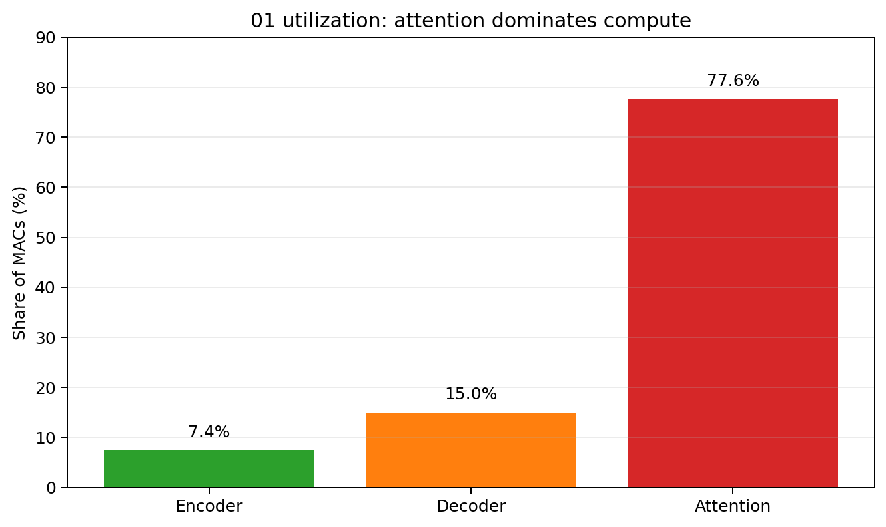
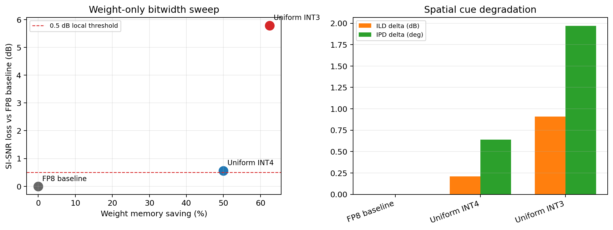
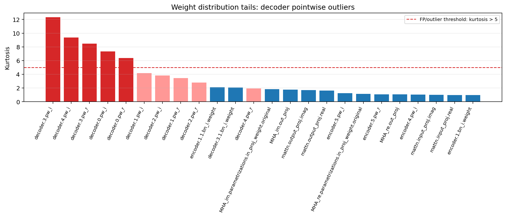
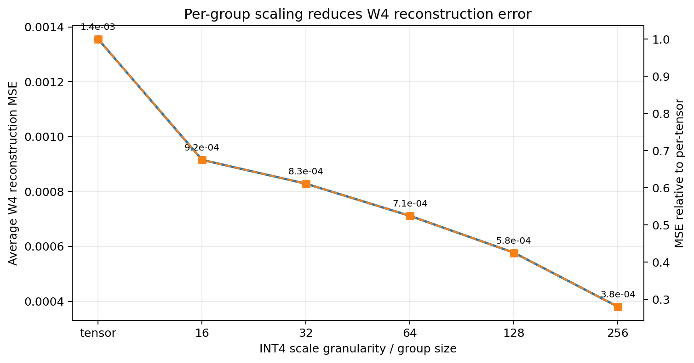
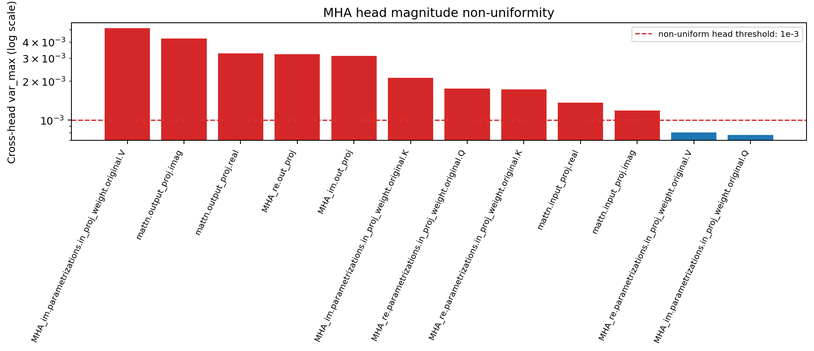
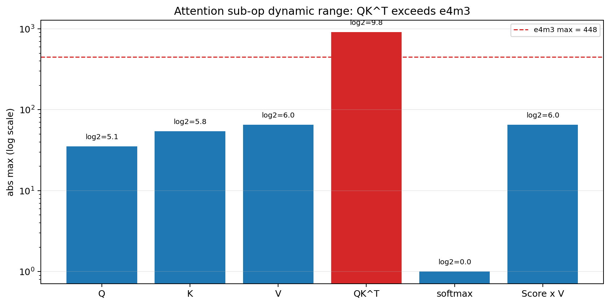
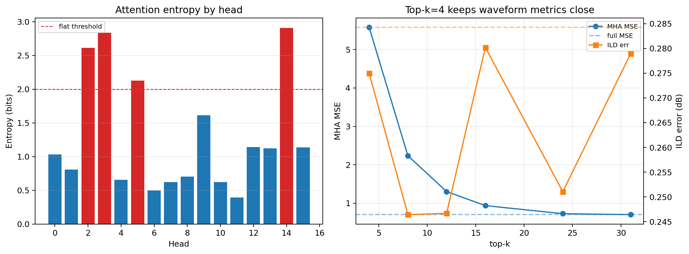
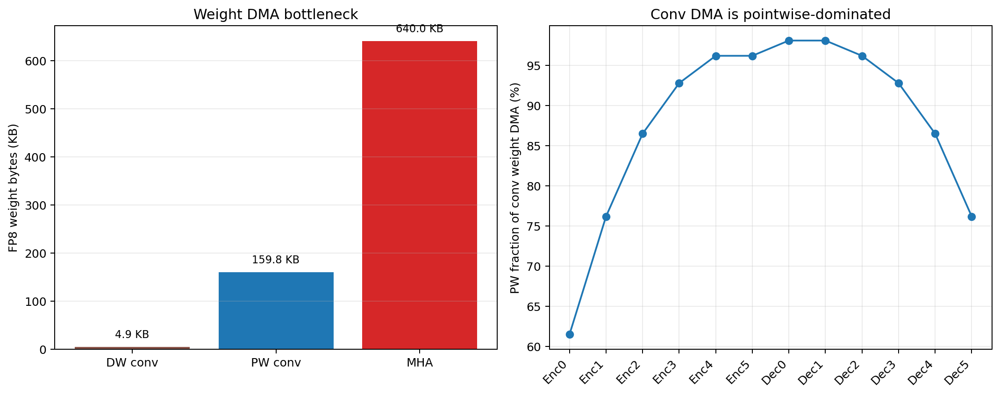
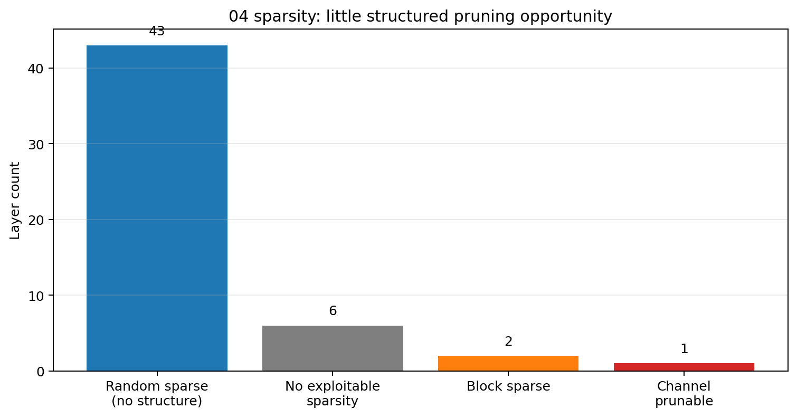
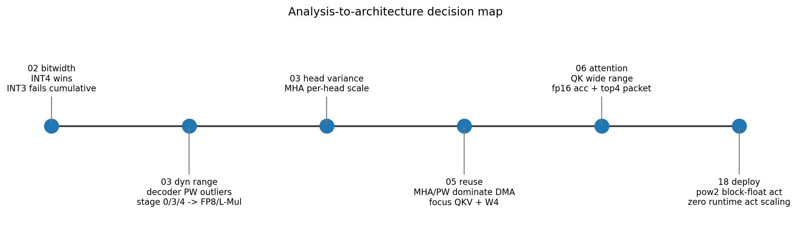

# Dynamic Range / Quantization Analysis Figures

這份文件把早期 `/01`–`/06` 分析中，真正影響後續硬體架構與量化 bit-width 決策的結果整理成圖表。
重點不是重新跑實驗，而是把既有分析結果轉成可交接給硬體顧問看的視覺化摘要。

所有圖都由 `scripts/make_dynamic_range_figures.py` 從既有 CSV/JSON/markdown 數字產生。
圖檔位於 `docs/analysis_figures/`。

---

## 1. Utilization：為什麼先看 attention / MHA



**資料來源**

- `/raid/R12K41024/01_utilization_analysis/01_utilization_analysis_report.md`

**讀法**

- attention 佔整體 MAC 約 **77.6%**，decoder 約 15.0%，encoder 約 7.4%。
- W4A8 對 average utilization 幾乎沒有幫助；真正問題是 attention weight / activation transport 與 WBUF residency。

**導致的架構決策**

- 後續優先處理 MHA：tied MHA、QKV grouping、top-4 sparse packet、MHA weights INT4。
- conv 端主要處理 decoder pointwise outlier 與 grouped pointwise，不把 DW conv 當主要優化目標。

---

## 2. Bit-width sweep：為什麼主路徑選 W4A8



**資料來源**

- `/raid/R12K41024/02_weights_bitwidth/02_weights_bitwidth_analysis_summary.md`

**讀法**

- `Uniform INT4`：weight memory saving 50%，SI-SNR loss 約 0.56 dB，ILD/IPD degradation 仍可接受。
- `Uniform INT3`：雖然 memory saving 62.5%，但整網路同時套用時 SI-SNR 掉到 4.701 dB，明顯失敗。

**導致的架構決策**

- 主路徑採 **W4A8**，不採 W3。
- INT4 需要 scale 幫忙吸收 layer/head/group 間 dynamic range，不應只靠 global scale。

---

## 3. Weight kurtosis / outlier：decoder pointwise 是特殊層



**資料來源**

- `/raid/R12K41024/03_dynamic_range/results_0410/dynamic_range_table.csv`
- `/raid/R12K41024/03_dynamic_range/03_dynamic_range_discussion_report.md`

**讀法**

- 紅線是 early analysis 使用的 outlier threshold：`kurtosis > 5`。
- 超過門檻的重尾分布集中在 **decoder pointwise stage 0 / 3 / 4**。
- Encoder 與 MHA weight kurtosis 明顯低很多，適合 INT4 + scale。

**導致的架構決策**

- decoder stage 0/3/4 的 pointwise 不走一般 INT4 conv 路徑，而成為 **FP8 outlier / L-Mul m4** 路徑。
- 在 final grouped decoder 中，原本的 decoder pointwise 被拆成 `x` / `skip` branch 與 real/imag 子 conv，所以 early analysis 的 stage 0/3/4 outlier 對應到 final export 的 **12 個 FP8 outlier dirs**。

---

## 4. Group-size trend：per-group scale 是必要的



**資料來源**

- `/raid/R12K41024/03_dynamic_range/results_0410/group_size_sensitivity.csv`

**讀法**

- per-tensor scale 的 W4 reconstruction MSE 最高。
- 導入 per-group scale 後，MSE 明顯下降；group size 越小，重建誤差越低，但 scale metadata / PPU 負擔越高。

**導致的架構決策**

- 不採單一 per-tensor scale。
- final strict18 export 對 pointwise / linear 使用 **per-group or per-head scale**，再把 scale 量化成 APoT / pow2 形式以符合 zero-multiplier core。
- 早期分析曾把 `group_size=256` 當作低 overhead 建議；後續 QAT/export 為了品質與硬體一致性，final handoff 使用更細的 per-group 設計（例如 pointwise group-32、MHA per-head）。

---

## 5. MHA per-head variance：為什麼 MHA 需要 per-head scale



**資料來源**

- `/raid/R12K41024/03_dynamic_range/results_0410/per_head_variance.csv`
- `/raid/R12K41024/03_dynamic_range/results_0410/summary.md`

**讀法**

- 多數 MHA tensor 的 `var_max` 超過 `1e-3`，代表 head 間 weight magnitude 不均勻。
- 直接用 per-tensor scale 會被高 magnitude head 拉大 scale，使其他 head 的 INT4 resolution 變差。

**導致的架構決策**

- MHA `in_proj` / `out_proj` 和 outer `mattn.input_proj/output_proj` 走 **per-head APoT scale**。
- 這也支撐後面 QKV grouping：head/group 是自然硬體切分單位。

---

## 6. Attention sub-op dynamic range：QK accumulator 不能當一般 FP8 activation



**資料來源**

- `/raid/R12K41024/06_attn_mised_precision/results/dynamic_range_per_subop.csv`
- `/raid/R12K41024/06_attn_mised_precision/06_attn_mised_precision_analysis_report.md`

**讀法**

- Q/K/V 與 Score×V 的 abs max 約 35–65。
- **QK^T abs max = 911.5**，超過 e4m3 max 448。
- softmax 後 attention weight 在 `[0,1]`，是最容易 packetize / quantize 的階段。

**導致的架構決策**

- QK / Score×V 使用 **fp16 accumulator**，不是把中間 accumulator 壓成 FP8 activation。
- QK scale `1/sqrt(16)=1/4` 必須在 softmax 前套，不能拖到 softmax 後。
- Score×V 走 top-4 q0.8 packet × e4m3 V，再用 L-Mul m8；`/256` 是 q0.8 exponent offset，不是 APoT scaler。

---

## 7. Attention entropy / top-k trend：為什麼使用 top-4 sparse packet



**資料來源**

- `/raid/R12K41024/06_attn_mised_precision/results/attention_entropy.csv`
- `/raid/R12K41024/06_attn_mised_precision/results/topk_eval.csv`

**讀法**

- 12/16 heads 是 sharp heads；flat heads 主要是 2、3、5、14。
- top-k 越小，MHA MSE 上升，但 waveform 指標並沒有等比例惡化。
- `k=4` 的 ILD / SI-SNR 與 full attention 非常接近。

**導致的架構決策**

- attention prob 不存 dense 31-entry FP16 row。
- final datapath 使用 **top-4 sparse q0.8 packet**：每 row 約 52 bits，Score×V 只 gather 4 個 V row。

---

## 8. DMA / reuse：為什麼優先壓 MHA 與 pointwise



**資料來源**

- `/raid/R12K41024/05_conv_reuse/results/dw_pw_breakdown.csv`
- `/raid/R12K41024/05_conv_reuse/05_conv_reuse_analysis_report.md`

**讀法**

- DW conv weight 很小，所有 DW 合計約 4.9 KB。
- PW conv 佔 conv weight DMA 約 97%。
- MHA FP8 real+imag weights 約 640 KB，比所有 PW conv 合計還大。

**導致的架構決策**

- W4A8 的主要價值是 **weight SRAM/DMA/WBUF residency**，不是提高 PE utilization。
- MHA/QKV 是真正大宗，所以後續架構做 tied MHA、grouped QKV、INT4 MHA weights。
- DW conv 適合 register/local buffer 常駐，不值得為它做複雜壓縮。

---

## 9. Sparsity：為什麼沒有把 pruning 當主線



**資料來源**

- `/raid/R12K41024/04_sparsity_analysis/results_test/sparsity_summary.json`
- `/raid/R12K41024/04_sparsity_analysis/results_test/weight_sparsity.csv`

**讀法**

- 多數 layer 是 random sparse 或 no exploitable sparsity。
- 只有極少數小層有 block/channel pruning 訊號，對整體 weight/MAC/DMA 幫助有限。

**導致的架構決策**

- 不把 unstructured pruning 當作 final hardware 主線。
- 改採 deterministic、硬體可排程的 structural changes：tied MHA、grouped QKV、decoder grouped pointwise、top-4 attention packet。

---

## 10. Analysis-to-architecture decision map



**讀法**

這張圖把前面幾個分析如何推到 final architecture 串起來：

1. `01_utilization_analysis`：attention dominates compute → 優先壓 MHA。
2. `02_weights_bitwidth`：INT4 可用、INT3 cumulative failure → W4A8。
3. `03_dynamic_range`：decoder PW stage 0/3/4 重尾 outlier → FP8 outlier + L-Mul m4。
4. `03_dynamic_range`：MHA head magnitude 不均勻 → per-head scale。
5. `04_sparsity_analysis`：缺少可用 structured sparsity → 不走 pruning 主線。
6. `05_conv_reuse`：MHA/PW 是 DMA 主因 → QKV grouping / W4 storage。
7. `06_attn_mised_precision`：QK accumulator 範圍太大 + top-k 幾乎不傷 waveform → fp16 accumulator + top-4 packet。
8. final `18`：APoT scale、L-Mul、pow2 block-float activation → zero-multiplier neural core。

---

## 重跑方式

```bash
cd /raid/R12K41024/18_w4a8_pow2_mixed_lmul_hw_handoff_20260530
MPLCONFIGDIR=/tmp/mpl_cache conda run -n bcctn python scripts/make_dynamic_range_figures.py
```

---

## Source index

| 圖 | 主要來源 |
|---|---|
| fig00 | `/raid/R12K41024/01_utilization_analysis/01_utilization_analysis_report.md` |
| fig01 | `/raid/R12K41024/02_weights_bitwidth/02_weights_bitwidth_analysis_summary.md` |
| fig02 | `/raid/R12K41024/03_dynamic_range/results_0410/dynamic_range_table.csv` |
| fig03 | `/raid/R12K41024/03_dynamic_range/results_0410/group_size_sensitivity.csv` |
| fig04 | `/raid/R12K41024/03_dynamic_range/results_0410/per_head_variance.csv` |
| fig05 | `/raid/R12K41024/06_attn_mised_precision/results/dynamic_range_per_subop.csv` |
| fig06 | `/raid/R12K41024/06_attn_mised_precision/results/attention_entropy.csv`, `/raid/R12K41024/06_attn_mised_precision/results/topk_eval.csv` |
| fig07 | `/raid/R12K41024/05_conv_reuse/results/dw_pw_breakdown.csv` |
| fig08 | 手動整理自 `01`–`06` 與 final `18` handoff |
| fig09 | `/raid/R12K41024/04_sparsity_analysis/results_test/sparsity_summary.json` |
